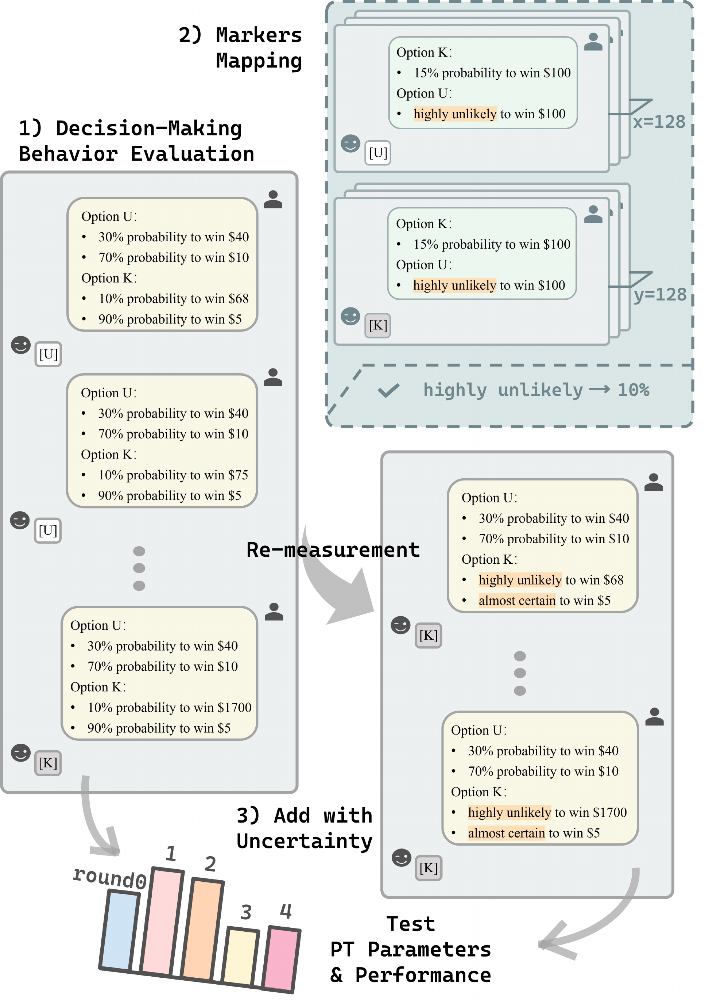

# \[EMNLP 2026 Main\] MarPT

📄 [arXiv](https://arxiv.org/abs/2508.08992) | [X Post](https://x.com/RuiWangRory/status/2090802609502433521?s=20)

This is the official repository for the paper "**Rethinking Prospect Theory for LLMs: Revealing the Instability of Decision-Making under Epistemic Uncertainty**".

## 🎯 Project Overview

**MarPT** investigates whether Prospect Theory (PT) — a classic framework for modeling human decision-making under uncertainty — adequately describes the decision-making behavior of Large Language Models (LLMs), and whether PT parameter estimates remain stable when numerical probabilities are replaced by linguistic uncertainty (epistemic markers such as *"likely"* or *"highly unlikely"*).

Grounded in a classic behavioral economics experimental paradigm, the repository provides:

* **📏 PT Parameter Estimation**: Estimates PT parameters (σ, λ, γ) of LLMs from economics-style binary-choice questions via maximum likelihood estimation
* **📊 Fitness Evaluation**: Evaluates how well the fitted PT model captures LLM decision-making with MAE and McFadden R²
* **🗣️ Marker Mapping**: Derives probability mappings for 14 epistemic markers (from *"almost certain"* to *"highly unlikely"*) in the same decision context
* **🔄 Stability Re-measurement**: Injects the derived marker mappings back into the prompts and re-measures PT parameters to test robustness under linguistic uncertainty

Our findings suggest that PT does **not** consistently provide a reliable account of LLM decision-making across models, and that its application to LLMs is likely **not robust** to epistemic uncertainty — cautioning against the deployment of PT-based frameworks in real-world applications where epistemic ambiguity is prevalent.

<p align="center">
  
</p>

*Figure 1: Overview of the three-stage workflow. (1) Decision-Making Behavior Evaluation: the model answers a series of binary-choice economics questions to estimate baseline PT parameters. (2) Markers Mapping: probability mappings for epistemic markers are derived from switching points between options with numerical and linguistic probabilities. (3) Add with Uncertainty: numerical probabilities are substituted with epistemic markers and PT parameters are re-measured to test stability.*

## ✨ Core Features

* **🧪 Classic Experimental Paradigm**: A streamlined three-stage workflow adapted from behavioral economics (Tversky & Kahneman style lottery-choice tasks)
* **🤖 Multi-Model Support**: Evaluated on Llama-3.1-8B-Instruct, Mistral-7B-Instruct-v0.3, and Qwen2.5-7B/14B/32B-Instruct
* **🔌 Unified Generation Module**: A shared `VLLMGenerator` client that talks to any vLLM-served model via the OpenAI-compatible API
* **📈 MLE-based Estimation**: PT parameters fitted via maximum likelihood estimation with bootstrap confidence intervals
* **📝 14 Epistemic Markers**: Systematic probability mappings for a full spectrum of linguistic uncertainty expressions
* **🧩 Modular Design**: Each experimental stage is a self-contained directory with its own elicitation, processing, and analysis scripts

## 📁 Directory Structure

```
MarPT/
├── figures/                # Paper figures
├── generator/              # Unified LLM generation module
│   ├── client.py           # VLLMGenerator (OpenAI-compatible API client)
│   └── .sh/                # Server / batch scripts
├── risk/                   # Stage 1: baseline PT parameter estimation
├── marker/                 # Stage 2: probability mapping of epistemic markers
├── risk_marker/            # Stage 3: PT re-measurement with marker substitution
└── requirements.txt
```

Each stage directory is self-contained:

```
risk/ (and marker/, risk_marker/)
    |---plot/               # Visualization outputs
    |---processed/          # Measured parameters and processed results
    |---result/             # Raw elicitation outputs
    analyze.py              # Analysis and plotting
    elicitation.py          # Main experiment entry point
    mle.py                  # MLE fitting of PT parameters
    process.py              # Result processing
    prompt.py               # Prompt construction
```

## 🔄 Workflow

```
1. Stage 1 — Baseline PT Estimation (risk/)
   Binary-choice questions with numerical probabilities
   └── MLE fitting → baseline PT parameters (σ, λ, γ) + fitness metrics

2. Stage 2 — Marker Mapping (marker/)
   Switching-point elicitation between numerical and linguistic probabilities
   └── Probability mapping for each epistemic marker (e.g., "highly unlikely" → 10%)

3. Stage 3 — Re-measurement under Uncertainty (risk_marker/)
   Numerical probabilities replaced by epistemic markers
   └── Re-estimated PT parameters → stability comparison against baseline
```

## 🚀 Quick Start

### Installation

Python 3.9 or later is recommended. Install the experiment and analysis dependencies:

```bash
git clone https://github.com/HKUST-KnowComp/MarPT.git
cd MarPT
python -m venv .venv
source .venv/bin/activate
pip install -r requirements.txt
```

The vLLM server can run in the same environment or on a separate Linux GPU machine. Install vLLM in the server environment according to its CUDA/PyTorch setup:

```bash
pip install vllm
```

### Model Deployment

Start one model with vLLM. Use the exact same model identifier in the server command and in the stage's `models_to_test` list:

```bash
vllm serve Qwen/Qwen2.5-7B-Instruct --port 8000
```

Wait for model loading to finish, then verify the OpenAI-compatible endpoint:

```bash
curl http://localhost:8000/v1/models
```

The experiments use `http://localhost:8000/v1` by default. If the server is on another host or port, set:

```bash
export VLLM_BASE_URL=http://your-server:8000/v1
```

`generator/.sh/vllm_serve.sh` is an optional example for launching four models on GPUs 0-3 and ports 40001-40004. It creates `generator/vllm_logs/` automatically. Run one experiment against one of those ports at a time by setting `VLLM_BASE_URL`, for example:

```bash
bash generator/.sh/vllm_serve.sh
export VLLM_BASE_URL=http://localhost:40002/v1
```

The batch script requires four visible GPUs and enough memory for all four models. For a single-GPU setup, use the single `vllm serve` command above.

### Experiment Configuration

Before running a stage, open its `elicitation.py` and configure:

* `models_to_test`: model identifiers served by the selected vLLM endpoint
* `sample_num`: number of elicitation runs
* `batchsize`: samples generated together in each run
* `history`: conversation history retained by Stage 1 and Stage 3

For a connectivity smoke test, use `sample_num = 1` and `batchsize = 1`. A single Stage 1 or Stage 3 run makes 35 rounds of requests. A complete Stage 2 run covers 14 markers with 10 lotteries each, so even its smoke test is substantially longer. The scripts append valid responses to an existing model result file; choose the output/model name carefully when repeating experiments.

### Stage 1: Baseline PT Estimation

Run commands from the stage directory so local imports and output paths resolve consistently:

```bash
cd risk
python elicitation.py
python process.py > process.log
cd ..
```

Raw model responses are appended to `risk/result/<model>.json`. MLE parameters, bootstrap confidence intervals, MAE, and McFadden R² are written to `risk/processed/<model>.json`.

### Stage 2: Epistemic Marker Mapping

```bash
cd marker
python elicitation.py
python process.py > result.txt
cd ..
```

Raw responses are stored in `marker/result/`; the 14 marker switching probabilities are written to `marker/processed/`.

### Stage 3: Re-measurement with Markers

Stage 3 must use a model supported by `risk_marker/prompt.py:safe_sub`. The repository currently provides mappings for Llama-3.1-8B-Instruct, Mistral-7B-Instruct-v0.3, and Qwen2.5-7B/14B/32B-Instruct.

```bash
cd risk_marker
python elicitation.py
python process.py > process.log
cd ..
```

Raw responses are stored in `risk_marker/result/`; re-estimated PT parameters and fit metrics are written to `risk_marker/processed/`.

### Reprocessing Included Results

The repository already includes raw result JSON files. You can reproduce the processed outputs without a GPU or vLLM server:

```bash
(cd risk && python process.py > process.log)
(cd marker && python process.py > process.log)
(cd risk_marker && python process.py > process.log)
```

The MLE scripts use bootstrap sampling without a fixed random seed. Parameter point estimates and fit metrics are reproducible, while confidence interval endpoints may vary slightly between runs.

### Customizing Marker Substitution (Stage 3 only)

To customize how epistemic markers replace numerical probabilities:

1. Open `risk_marker/prompt.py`
2. Modify the function `safe_sub` as needed

## 📝 Notes

* The `generator/` module provides a unified `VLLMGenerator` class used by all three stages.
  * `risk/` and `risk_marker/` use **chat completion** (`/v1/chat/completions`) with multi-turn conversations.
  * `marker/` uses **text completion** (`/v1/completions`) with raw prompts.
* The model identifier in `models_to_test` must match a model returned by `/v1/models`.
* Processing and analysis do not require vLLM; only elicitation sends model requests.
* Qwen3 currently has complete Stage 1 data but only partial Stage 2 data in this repository, and it is not configured for Stage 3 marker substitution.

## 📚 Citing this work

If you use this codebase in your research, please cite:

```bibtex
@misc{wang2025rethinkingprospecttheoryllms,
      title={Rethinking Prospect Theory for LLMs: Revealing the Instability of Decision-Making under Epistemic Uncertainty},
      author={Rui Wang and Qihan Lin and Jiayu Liu and Qing Zong and Tianshi Zheng and Dadi Guo and Haochen Shi and Peixuan Han and Weiqi Wang and Yangqiu Song},
      year={2025},
      eprint={2508.08992},
      archivePrefix={arXiv},
      primaryClass={cs.AI},
      url={https://arxiv.org/abs/2508.08992},
}
```

## 📄 License

MIT
