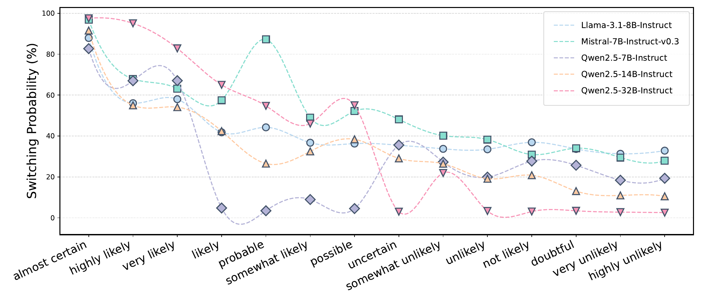
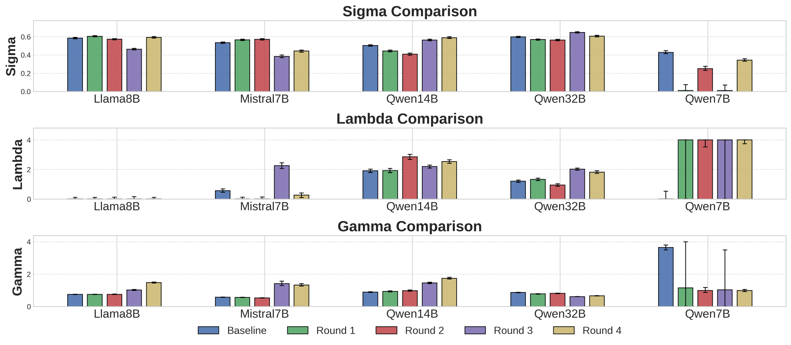
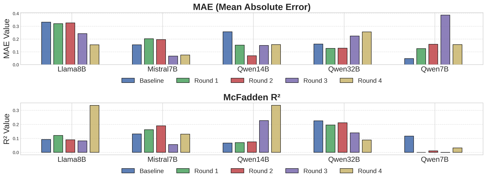

# MarPT

📄 [arXiv](https://arxiv.org/abs/2508.08992)

This is the official repository for the paper "**Rethinking Prospect Theory for LLMs: Revealing the Instability of Decision-Making under Epistemic Uncertainty**".

## 🎯 Project Overview

**MarPT** investigates whether Prospect Theory (PT) — a classic framework for modeling human decision-making under uncertainty — adequately describes the decision-making behavior of Large Language Models (LLMs), and whether PT parameter estimates remain stable when numerical probabilities are replaced by linguistic uncertainty (epistemic markers such as *"likely"* or *"highly unlikely"*).

Grounded in a classic behavioral economics experimental paradigm, the repository provides:

* **📏 PT Parameter Estimation**: Estimates PT parameters (σ, λ, γ) of LLMs from economics-style binary-choice questions via maximum likelihood estimation
* **📊 Fitness Evaluation**: Evaluates how well the fitted PT model captures LLM decision-making with MAE and McFadden R²
* **🗣️ Marker Mapping**: Derives probability mappings for 14 epistemic markers (from *"almost certain"* to *"highly unlikely"*) in the same decision context
* **🔄 Stability Re-measurement**: Injects the derived marker mappings back into the prompts and re-measures PT parameters to test robustness under linguistic uncertainty

Our findings suggest that PT does **not** consistently provide a reliable account of LLM decision-making across models, and that its application to LLMs is likely **not robust** to epistemic uncertainty — cautioning against the deployment of PT-based frameworks in real-world applications where epistemic ambiguity is prevalent.

<p align="center">
  
</p>

*Figure 1: Overview of the three-stage workflow. (1) Decision-Making Behavior Evaluation: the model answers a series of binary-choice economics questions to estimate baseline PT parameters. (2) Markers Mapping: probability mappings for epistemic markers are derived from switching points between options with numerical and linguistic probabilities. (3) Add with Uncertainty: numerical probabilities are substituted with epistemic markers and PT parameters are re-measured to test stability.*

## ✨ Core Features

* **🧪 Classic Experimental Paradigm**: A streamlined three-stage workflow adapted from behavioral economics (Tversky & Kahneman style lottery-choice tasks)
* **🤖 Multi-Model Support**: Evaluated on Llama-3.1-8B-Instruct, Mistral-7B-Instruct-v0.3, and Qwen2.5-7B/14B/32B-Instruct
* **🔌 Unified Generation Module**: A shared `VLLMGenerator` client that talks to any vLLM-served model via the OpenAI-compatible API
* **📈 MLE-based Estimation**: PT parameters fitted via maximum likelihood estimation with bootstrap confidence intervals
* **📝 14 Epistemic Markers**: Systematic probability mappings for a full spectrum of linguistic uncertainty expressions
* **🧩 Modular Design**: Each experimental stage is a self-contained directory with its own elicitation, processing, and analysis scripts

## 📁 Directory Structure

```
MarPT/
├── figures/                # Paper figures
├── generator/              # Unified LLM generation module
│   ├── client.py           # VLLMGenerator (OpenAI-compatible API client)
│   └── .sh/                # Server / batch scripts
├── risk/                   # Stage 1: baseline PT parameter estimation
├── marker/                 # Stage 2: probability mapping of epistemic markers
├── risk_marker/            # Stage 3: PT re-measurement with marker substitution
└── requirements.txt
```

Each stage directory is self-contained:

```
risk/ (and marker/, risk_marker/)
    |---plot/               # Visualization outputs
    |---processed/          # Measured parameters and processed results
    |---result/             # Raw elicitation outputs
    analyze.py              # Analysis and plotting
    elicitation.py          # Main experiment entry point
    mle.py                  # MLE fitting of PT parameters
    process.py              # Result processing
    prompt.py               # Prompt construction
```

## 🔄 Workflow

```
1. Stage 1 — Baseline PT Estimation (risk/)
   Binary-choice questions with numerical probabilities
   └── MLE fitting → baseline PT parameters (σ, λ, γ) + fitness metrics

2. Stage 2 — Marker Mapping (marker/)
   Switching-point elicitation between numerical and linguistic probabilities
   └── Probability mapping for each epistemic marker (e.g., "highly unlikely" → 10%)

3. Stage 3 — Re-measurement under Uncertainty (risk_marker/)
   Numerical probabilities replaced by epistemic markers
   └── Re-estimated PT parameters → stability comparison against baseline
```

## 📊 Key Results



*Figure 2: Derived probability mappings (switching probability) for 14 epistemic markers across five instruction-tuned LLMs. The mappings vary substantially across models and do not follow a consistent ordering.*



*Figure 3: Estimated PT parameters (σ, λ, γ) at baseline and across four re-measurement rounds with epistemic markers. Parameter estimates drift considerably once linguistic uncertainty is introduced.*



*Figure 4: PT fitness measured by MAE (lower is better) and McFadden R² (higher is better). The fitted PT model captures LLM decision-making inconsistently across models and rounds.*

## 🚀 Quick Start

### Installation

```bash
git clone https://github.com/HKUST-KnowComp/MarPT.git
cd MarPT
pip install -r requirements.txt
```

### Model Deployment

Start a vLLM server with your target model:

```bash
vllm serve Qwen/Qwen3-32B --port 8000
```

The experiments expect an OpenAI-compatible API at `http://localhost:8000/v1` by default. You can override this with the `VLLM_BASE_URL` environment variable:

```bash
export VLLM_BASE_URL=http://your-server:8000/v1
```

### Running an Experiment

Navigate to the directory of the stage you want to run (e.g., Stage 1 baseline):

```bash
cd risk
```

Configure the target model(s):

1. Open `elicitation.py`
2. Edit `models_to_test` to select your target model(s)
3. Optionally adjust `base_url`, `sample_num`, and `batchsize`

Run elicitation and process the results:

```bash
# Elicitation — raw outputs are saved under result/
python elicitation.py

# Processing — measured parameters are saved in processed/
python process.py > result.txt
```

### Customizing Marker Substitution (Stage 3 only)

To customize how epistemic markers replace numerical probabilities:

1. Open `risk_marker/prompt.py`
2. Modify the function `safe_sub` as needed

## 📝 Notes

* The `generator/` module provides a unified `VLLMGenerator` class used by all three stages.
  * `risk/` and `risk_marker/` use **chat completion** (`/v1/chat/completions`) with multi-turn conversations.
  * `marker/` uses **text completion** (`/v1/completions`) with raw prompts.
* For **Qwen3** models, thinking mode is automatically disabled via `chat_template_kwargs`.
* For **QwQ** models, a system message suppressing reasoning is automatically prepended.
* Ensure the vLLM model server is running before starting any elicitation.

## 📚 Citing this work

If you use this codebase in your research, please cite:

```bibtex
@misc{wang2025rethinkingprospecttheoryllms,
      title={Rethinking Prospect Theory for LLMs: Revealing the Instability of Decision-Making under Epistemic Uncertainty},
      author={Rui Wang and Qihan Lin and Jiayu Liu and Qing Zong and Tianshi Zheng and Dadi Guo and Haochen Shi and Peixuan Han and Weiqi Wang and Yangqiu Song},
      year={2025},
      eprint={2508.08992},
      archivePrefix={arXiv},
      primaryClass={cs.AI},
      url={https://arxiv.org/abs/2508.08992},
}
```

## 📄 License

MIT
